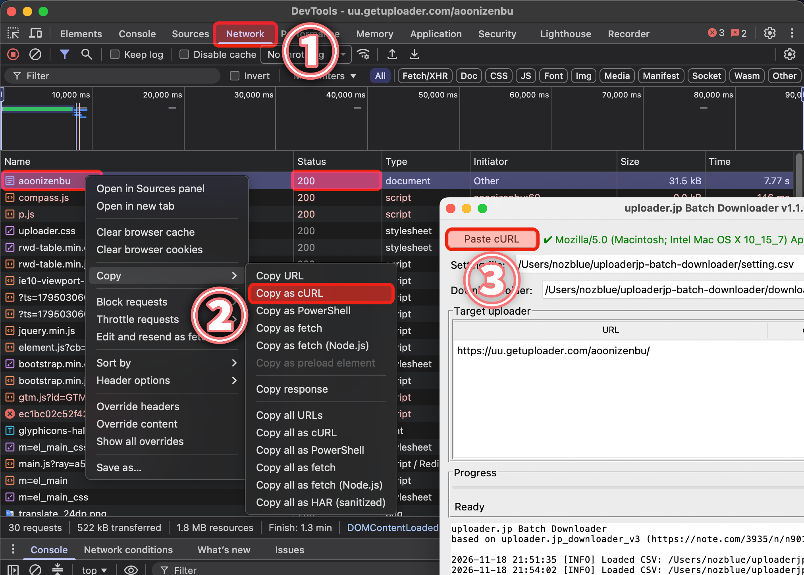

# uploader.jp Batch Downloader / uploader.jp 一括ダウンローダー

## Usage / 使い方

<video controls preload="metadata" style="width:100%; border-radius:8px; background:#000;">
<source src="assets/Downloader.mp4" type="video/mp4">
Click the article to watch the video.
</video>

### Basics / 基本

On first launch, a new file called "setting.csv" will be generated. You can edit this file in text editors or Excel to add more target uploaders.

For more details, check out the [original author's guide](https://note.com/3935/n/n9011ee06eb78#7f19fd50-0f80-4554-8308-95926b251952). [Original version](https://note.com/3935/n/n9011ee06eb78#94997b0a-598f-4e2f-b924-752972e75293) includes example CSV file.

---

初回起動時、"setting.csv" というファイルが生成されるので、テキストエディタやエクセルで編集して対象のアップローダーを追加できます。

詳しい使い方は[原作者の解説](https://note.com/3935/n/n9011ee06eb78#7f19fd50-0f80-4554-8308-95926b251952)を参照してください。[オリジナル版](https://note.com/3935/n/n9011ee06eb78#94997b0a-598f-4e2f-b924-752972e75293)はCSVファイルも同梱されています。

---

### v1.1 Update / v1.1での変更点

The Batch Downloader has now been updated to work around bot protection that has been added to the website.

To use it, open an uploader page in a Chromium-based browser (Chrome, Edge, Brave, etc.) (complete any Cloudflare verification if it appears), open `DevTools` and go to `Network` tab.
Then, right-click on "Uploader ID" (e.g. `aoonizenbu` for URL "https://uu.getuploader.com/aoonizenbu/") and `Copy > Copy as cURL`.

- if Uploader ID doesn't appear, keep the DevTools opened and reload the page.
- if there are two, copy the one with **`Status 200`**, not 302.

After that, you can paste the command using the downloader's top button (`Paste cURL`). The browser's Cookie might expire (`Cloudflare Blocked` error) while downloading, so **you might have to do this multiple times**.

---

一括ダウンローダーが更新され、サイトのボット検知を回避するようになりました。

使うには、アップローダーのページをChromium系のブラウザー (Chrome, Edge, Brave等) で開き (Cloudflareの画面が出たら認証を完了してください)、`デベロッパー ツール`を開いて`ネットワーク (Network)`タブを開きます。
そして、"アップローダーID" ("https://uu.getuploader.com/aoonizenbu/"なら`aoonizenbu`) を右クリックし、`コピー > cURLとしてコピー (Copy > Copy as cURL)`を押してください。

- アップローダーIDが表示されない場合は、デベロッパー ツールを開いたままページを更新してください。
- 2つある場合は、**`Status 200`** (302ではない方) を選んでください。

それから、ダウンローダーの上部のボタン (`cURLペースト`) を押すと貼り付けることができます。ダウンロード中にブラウザのCookieが期限切れ (`Cloudflareブロック` エラー) になった場合は、同じ手順で貼り付け直してください。

## Disclaimer / 免責事項

Even as the service is ceasing, do not abuse this tool or cause trouble for uploader.jp or its uploaders, including by making excessive requests or downloading files without permission. You are responsible for how you use this tool. The author has no responsibility for any resulting trouble or damage.

サービス終了が近いからといって、過度なアクセスや無断ダウンロードなど、uploader.jpや各アップローダーに迷惑をかける使い方はしないでください。本ツールの利用は自己責任です。利用によって生じたトラブルや損害について、作者は責任を負いません。

## Credit / クレジット

- [Original (uploader.jp_downloader_v3)](https://note.com/3935/n/n9011ee06eb78) by ﾏﾝﾊｯﾀﾝｶﾌｪ
- [TkEasyGUI](https://github.com/kujirahand/tkeasygui-python)

## License / ライセンス

Distributed under the [GPLv3](LICENSE).
